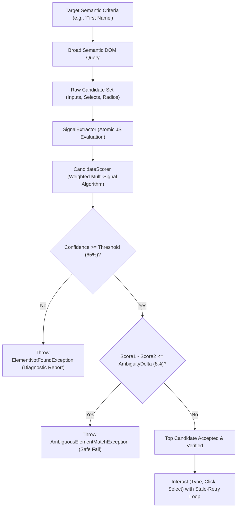

# Architecture & Resilience Design Document

## 1. Executive Summary & Design Philosophy
`ResilientSeleniumAutomation` is a production-grade test automation architecture designed for high-change web environments. Traditional Selenium automation frameworks bind test logic to rigid, fragile locators such as static XPaths (`/html/body/div[2]/form/div[1]/input`), internal IDs (`#fname`), or transient CSS classes (`.form-control.col-xs-6`). In modern dynamic web applications, continuous deployment, component refactoring, DOM reordering, and front-end obfuscation break traditional locators, causing false-positive test suite failures and high maintenance overhead.

This solution implements a **multi-signal heuristic locator engine** that evaluates candidate elements in the DOM using a probabilistic scoring model across independent semantic dimensions (labels, visible nearby text, accessible attributes, HTML5 control semantics, container hierarchy, and option domain content).

---

## 2. Component Hierarchy & Responsibilities

### 2.1 Configuration Layer (`ResilientSeleniumAutomation.Core.Configuration`)
- **`AutomationSettings`**: Strongly-typed model holding:
  - `BaseUrl`: Default target URL (`https://app.cloudqa.io/home/AutomationPracticeForm`). Never hardcoded in page objects.
  - `Browser`: `Chrome`, `Edge`, or `Firefox`.
  - `Headless`: Toggle for CI/CD or local debugging.
  - `TimeoutSeconds` & `PollingIntervalMs`: Dynamic polling waits.
  - `MaxRetryAttempts`: Bounded retry count for stale DOM recovery.
  - `ConfidenceThreshold`: Minimum normalized score (default `0.65` / 65%) to accept an element.
  - `AmbiguityDeltaThreshold`: Score difference delta (default `0.08` / 8%) that triggers an ambiguity abort.
- **`ConfigurationManager`**: Hierarchical configuration provider implementing precedence:
  $$\text{CLI Arguments} > \text{Environment Variables (RESILIENT\_AUTOMATION\_*)} > \text{appsettings.json} > \text{Defaults}$$

### 2.2 WebDriver Factory (`ResilientSeleniumAutomation.Core.Drivers`)
- **`DriverFactory`**: Instantiates cross-browser `IWebDriver` sessions with:
  - Automated binary resolution via Selenium 4's built-in **Selenium Manager**.
  - Headless execution flags (`--headless=new`).
  - Viewport stabilization (`--window-size=1920,1080`).
  - Anti-detection toggles (`--disable-blink-features=AutomationControlled`).
  - Zero implicit waits to ensure clean explicit polling behavior.

### 2.3 Resilient Element Identification Engine (`ResilientSeleniumAutomation.Core.Resilience`)
- **`TargetElementCriteria`**: High-level semantic specification defining:
  - `SemanticLabel`: Core intent (e.g. "First Name", "Gender", "State").
  - `AlternativeLabels`: Synonyms, slugs, or token variants (`fname`, `forename`, `given name`).
  - `ExpectedControlType`: Enum (`TextInput`, `RadioButtonOption`, `DropdownSelect`).
  - `OptionValue`: Specific radio/select option targeted (`Male`, `United States`).
  - `ExpectedOptions`: Sample valid option texts for domain matching.
  - `ContextHints`: Form IDs, headings, or section tokens (`automationtestform`, `Form`).
- **`SignalExtractor`**: High-performance signal extraction pipeline executing in a single atomic JavaScript pass (with WebDriver API fallback):
  1. Associated `<label for="id">` or `` (scoped to the same enclosing `<form>`).
  2. Ancestor wrapping `<label>`.
  3. Preceding and following sibling `<label>` and `` elements.
  4. Ancestor container text (from enclosing `.form-group`, `<fieldset>`, or `role="group"`).
  5. Adjacent radio/checkbox option text.
  6. Accessibility attributes (`aria-label`, `aria-labelledby`, `title`).
  7. Input type, placeholder, and attribute tokens (`id`, `name`, `class`).
  8. Available `<option>` text and values for dropdowns.
  9. Visibility (`offsetWidth > 0 || offsetHeight > 0`) and enabled status.
- **`CandidateScorer`**: Multi-signal scoring engine calculating composite confidence:
  $$S = S_{\text{visibility}} + S_{\text{type}} + S_{\text{label}} + S_{\text{context/option}} + S_{\text{a11y}} + S_{\text{tokens}} + S_{\text{domain}} + S_{\text{hints}}$$
- **`ResilientElementFinder`**: Orchestrates candidate discovery without fixed paths:
  - Queries broad DOM sets (`//input`, `//select`).
  - Handles `StaleElementReferenceException` with bounded retries and exponential backoff.
  - Formats diagnostic ASCII tables upon low confidence or ambiguity.
- **`DropdownHandler`**: Production wrapper for dropdown interactions:
  - Validates that the underlying element is a native HTML `<select>`.
  - Accurately throws `UnsupportedDropdownException` when custom components (such as Bootstrap button dropdowns or div/ul menus) are targeted.
  - Provides fuzzy, case-insensitive, and trimmed option selection via `SelectElement`.

### 2.4 Page Object Model (`ResilientSeleniumAutomation.Core.Pages`)
- **`FormPage`**: Clean, business-readable POM:
  - `Navigate(url = null)`: Navigates using configured `BaseUrl`.
  - `EnterFirstName(firstName)` & `GetFirstName()`.
  - `SelectGender(genderOption)` & `GetSelectedGender()`.
  - `SelectState(stateOption)` & `GetSelectedState()`.
  - `InspectCustomDropdown()`: Validates unsupported custom dropdown handling.

---

## 3. Mathematical Scoring Formulation & Weights

The scoring algorithm assigns points across eight independent dimensions, normalizing to a score in $[0.0, 1.0]$:

| Signal Dimension | Maximum Weight | Description & Scoring Logic |
| :--- | :---: | :--- |
| **Visibility & Enabled** | $0.20$ | **Gatekeeper**: Displayed & Enabled = $+0.20$; Displayed & Disabled = $+0.05$; Hidden/Off-screen = $0.00$ (disqualifies element). |
| **Control Type & Semantic HTML** | $0.20$ | Matches semantic target: TextInput $\rightarrow$ `input[text]` ($+0.20$), `textarea` ($+0.15$); RadioOption $\rightarrow$ `input[radio]` ($+0.20$); Dropdown $\rightarrow$ `<select>` ($+0.20$). |
| **Explicit Associated Label** | $0.25$ | Evaluates `<label for="id">`, ``, wrapping label, or adjacent sibling. Exact match = $+0.25$; Substring/Token = $+0.20$. Scoped to same form. |
| **Context & Option Text** | $0.25$ | **Radio Option**: Option text match (`\bTarget\b`) = $+0.15$; Group container label ("Gender") = $+0.10$. **Text**: Container label match = $+0.10$. |
| **Accessible Name & Placeholder** | $0.15$ | `aria-label` / `aria-labelledby` = $+0.15$; `placeholder` match = $+0.10$; `title` = $+0.10$. |
| **Attribute Semantic Tokens** | $0.10$ | Token overlap on `id`, `name`, `class` (e.g. `fname` $\rightarrow$ "first name", `gender` $\rightarrow$ "Gender") = $+0.10$. |
| **Option Domain Match** | $0.10$ | For `<select>`: Requested option present in list = $+0.06$; Expected sample options ratio = $+0.04$. |
| **Form Context Hints** | $0.06$ | Exact match on ancestor `<form id>` or container = $+0.06$; Partial match = $+0.02$. |

### Word Boundary Matching
To prevent false-positive substring matches (e.g., `"Female".Contains("Male")`), the token similarity engine uses regular expression word boundaries:
$$\text{Pattern} = \backslash\text{b}\text{Target}\backslash\text{b}$$
This guarantees `"Male"` matches `"Male"` ($1.0$), `"Radio Male"` ($0.90$), but produces $0.00$ against `"Female"`.

---

## 4. Ambiguity Detection & Safe Failure

### The Danger of Automated Guessing
In corporate and production automation, clicking or typing into the wrong field (e.g. submitting an amount into an account number field, or toggling the wrong user permission) is catastrophic. A resilient engine must never guess between two similarly plausible candidates.

### The Ambiguity Invariant
Let $C_1$ be the highest-scoring candidate with score $S_1$, and $C_2$ be the runner-up with score $S_2$:
$$\text{If } S_1 \ge \theta_{\text{confidence}} \quad \text{and} \quad S_2 \ge \theta_{\text{confidence}} \quad \text{and} \quad (S_1 - S_2) \le \Delta_{\text{ambiguity}}$$
The engine aborts execution immediately and throws `AmbiguousElementMatchException`, outputting a complete diagnostic comparison of both candidates and their signal breakdowns.

---

## 5. Architectural Boundaries & Limitations

Honest engineering requires recognizing the boundaries of heuristic element location:

1. **Genuinely Identical Markup in Same Form**:
   If a form contains two identical fields (e.g. "Phone Number 1" and "Phone Number 2" both rendered as `<input type="text" placeholder="Phone">` without unique labels or distinct container headers), heuristic automation cannot infer user intent and will trigger an ambiguity exception. A disambiguating context hint (e.g. container selector or index scope) is required.
2. **Custom / Virtualized Dropdowns**:
   Modern React/Vue/Angular dropdowns that simulate select menus using nested `
`, ``, and `<ul>` elements cannot be driven by standard Selenium `SelectElement`. The framework detects this and throws `UnsupportedDropdownException` with clear guidance to interact with custom menu items directly.
3. **Shadow DOM Boundaries**:
   Light DOM queries cannot penetrate encapsulated closed shadow roots. Elements nested inside multi-level open shadow roots require explicit shadow host traversal via `IJavaScriptExecutor` or Selenium 4's `GetShadowRoot()` API.
4. **Drastic Semantic Shifts**:
   If an application completely re-architects a workflow (e.g., replacing a 3-field personal information form with a conversational chatbot or a camera-based identity scanner), no locator strategy can bridge the gap; test workflow re-engineering is required.

